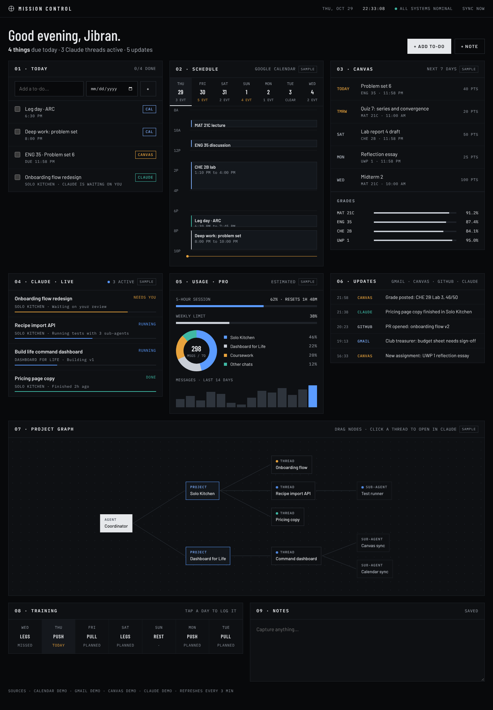

# Mission Control

A personal command console for one person's day: what Claude is working on, what's due, and what changed, on a single dark screen built to read like a launch console rather than a productivity app.



## What's on the screen

| Panel | Shows | Source |
| --- | --- | --- |
| 01 Today | One checklist that merges Canvas work due today, calendar items, Claude threads waiting on you, and your own to-dos | Everything below, plus to-dos you add here |
| 02 Schedule | A seven-day strip and an hour-by-hour timeline for today with a live "now" line | Google Calendar |
| 03 Canvas | Assignments for the next week and current course grades | Canvas API, or a scraper that pushes snapshots |
| 04 Claude · Live | Threads that are running, waiting on you, or recently finished | Claude snapshot |
| 05 Usage | Session and weekly limit bars, share of usage by project, and messages per day | Claude snapshot |
| 06 Updates | New grades, mail, PRs, and finished Claude work from the last two days | Gmail, Canvas, Claude snapshot |
| 07 Project graph | A draggable flow chart of agent → projects → threads → sub-agents. Clicking a node with a link opens it in Claude | Claude snapshot |
| 08 Training | This week's split; tap a day to log it | `GYM_SPLIT`, see `lib/config.ts` |
| 09 Notes | A scratchpad that autosaves | Stored in the database |

A source that isn't connected stays empty and is labelled **NOT CONNECTED**, so nothing on screen is ever made up. To try the dashboard with sample data instead, set `SAMPLE_DATA=1`. Data refreshes every three minutes and whenever the tab comes back into view.

## Run it locally

```bash
npm install
cp .env.example .env.local   # every value is optional
npm run dev                  # http://localhost:3000
```

Without a database configured, to-dos and notes are kept in memory until the server restarts.

## Deploy on Vercel

1. Import this repository at [vercel.com/new](https://vercel.com/new).
2. Under **Storage**, add an **Upstash Redis** database and connect it to the project. That sets `KV_REST_API_URL` and `KV_REST_API_TOKEN` for you.
3. Under **Settings → Environment Variables**, set `DASHBOARD_PASSWORD` and any of the sources below, then redeploy.

The code is public, but none of your data is: grades, mail, and calendar entries are only fetched at request time or kept in your own database, behind the password.

## Connecting sources

**Google Calendar and Gmail (read-only).** In [Google Cloud Console](https://console.cloud.google.com/), create a project, enable the Google Calendar API and the Gmail API, set up the OAuth consent screen (External, add yourself as a test user), and create an OAuth client of type *Desktop app*. Then:

```bash
GOOGLE_CLIENT_ID=... GOOGLE_CLIENT_SECRET=... npm run google-auth
```

Sign in when the URL opens, and copy the printed `GOOGLE_REFRESH_TOKEN` into your environment along with the client ID and secret.

**Canvas.** In Canvas, open **Account → Settings → New Access Token**, then set `CANVAS_BASE_URL` (for example `https://canvas.ucdavis.edu`) and `CANVAS_TOKEN`. If you'd rather keep using a scraper, leave those blank and have it push to the ingest endpoint instead.

**Docket.** If your coursework already lands in a Docket artifact, have each Docket sync finish by pushing its items here and reading back what you checked off:

```bash
# push: { items, tasks?, courses?, announcements?, grades? }  (DocketSnapshot in lib/sources/docket.ts)
curl -X POST https://<your-app>/api/ingest/docket -H "Authorization: Bearer $INGEST_TOKEN" -H "Content-Type: application/json" -d @docket.json
# pull: items checked off in Mission Control, to mark done in Docket
curl https://<your-app>/api/ingest/docket -H "Authorization: Bearer $INGEST_TOKEN"
```

**Claude.** Claude doesn't have a public API for your plan's usage or your projects, so the Claude panels read a snapshot that something else pushes, such as a scheduled Claude routine or a local script:

```bash
curl -X POST https://<your-app>/api/ingest/claude \
  -H "Authorization: Bearer $INGEST_TOKEN" \
  -H "Content-Type: application/json" \
  -d @snapshot.json
```

The snapshot shape is `ClaudeSnapshot` in [`lib/types.ts`](lib/types.ts): `usage` (plan, session and weekly percentages, share by project, messages per day), `threads`, `graph` (nodes and parent → child edges), and `updates`. Usage numbers are marked as estimates unless the pusher says otherwise. Canvas snapshots post to `/api/ingest/canvas` in the `CanvasData` shape.

## Stack

Next.js (App Router) and TypeScript, [React Flow](https://reactflow.dev) for the project graph, hand-drawn CSS for every chart, and Upstash Redis over REST for storage. There's no UI kit and no chart library. Type is Barlow, Barlow Condensed, and IBM Plex Mono.

## License

MIT
